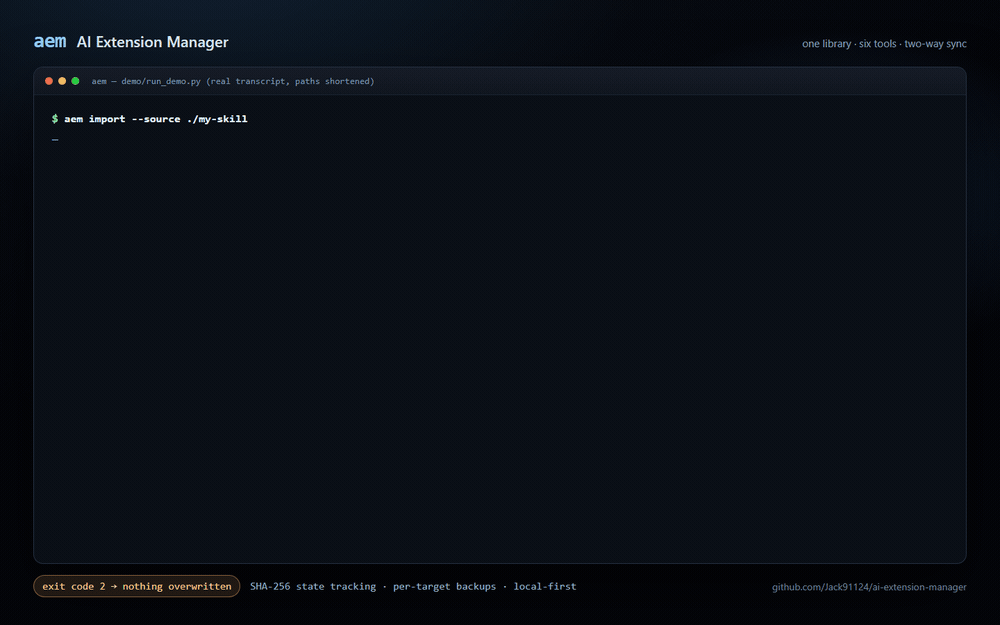

# AI Extension Manager

**English** | [简体中文](README.zh-CN.md)

### One library. Six AI tools. Two-way sync that never silently overwrites your work.

`aem` keeps your Agent Skills, rules and MCP server definitions in one local library and syncs
them to Claude Code, OpenAI Codex, Gemini CLI, Cursor, VS Code Copilot and DSH. It decides what
changed using SHA-256 content hashes and per-target sync records — never "the newest file wins".

**Website:** <https://jack91124.github.io/ai-extension-manager/> · [中文落地页](https://jack91124.github.io/ai-extension-manager/zh.html)

[](https://jack91124.github.io/ai-extension-manager/)
[](https://www.skills.sh/jack91124/ai-extension-manager)


[](https://github.com/Jack91124/ai-extension-manager/actions/workflows/ci.yml)
[](https://github.com/Jack91124/ai-extension-manager/releases/latest)


**Quick start** · [Why](#why-another-skill-manager) · [60-second workflow](#the-60-second-workflow) ·
[Conflict model](#how-conflicts-work) · [Support matrix](#what-is-supported-today) ·
[Safety](#safety-by-default) · [CLI](#cli-at-a-glance) · [Demo](demo/) · [Docs](#documentation)

---

## Why another skill manager?

Every AI coding tool invented its own folder: `~/.claude/skills`, `~/.codex/skills`,
`~/.gemini/skills`, `~/.cursor/skills`, `~/.copilot/skills`, `~/.dsh/skills`. In practice that means:

- the same skill is copied five times, then edited in three places;
- installing a skill for one tool leaves the other five behind;
- a "sync" script copies files and silently deletes last week's local fix;
- no one can answer "which tools have version 1.2 of this skill, and did any copy drift?"

`aem` treats a **central library as the source of truth** and records exactly what was distributed
to each tool. That record is what lets it distinguish "only the library changed" from "only the tool
changed" from "both changed" — and refuse to guess in the last case.

It is deliberately **local-first**: plain files, plain JSON, no server, no telemetry, no account.



<sub>10-second demo, rendered from the real `demo/run_demo.py` transcript ([static version](docs/hero.png), [how it is made](docs/make_demo_gif.py)).</sub>

## Quick start

Requires **Python 3.9+**. No third-party packages, on Windows, macOS or Linux.

Install without cloning (needs `git`; pin the tag for a reproducible install):

```bash
python -m pip install --user "git+https://github.com/Jack91124/ai-extension-manager.git@v1.0.4"
aem init && aem doctor
```

Prefer an isolated CLI? Use `pipx install "git+https://github.com/Jack91124/ai-extension-manager.git@v1.0.4"`,
or download the wheel from the [latest release](https://github.com/Jack91124/ai-extension-manager/releases/latest)
and `pip install` it.

Or clone the repository:

```bash
git clone https://github.com/Jack91124/ai-extension-manager.git
cd ai-extension-manager
python -m pip install .
aem init          # create ~/.ai-extension-manager
aem doctor        # check Python, paths, registry, locks and installed tools
aem scan          # detect the six tools and their skill folders
```

No install needed — every command also runs as `python scripts/aem.py <command>`.

Already use the [`skills`](https://github.com/vercel-labs/skills) CLI? Install it as an agent skill
(Node 22.20+), which also lists it on [skills.sh](https://www.skills.sh/jack91124/ai-extension-manager):

```bash
npx skills add Jack91124/ai-extension-manager
```

The repository root is a valid skill, so the CLI installs the whole toolkit (docs, scripts, evals)
into `.claude/skills/ai-extension-manager` or `.agents/skills/ai-extension-manager`.

A real `aem doctor` run on a Windows machine where three of the six tools are installed:

```text
$ aem doctor
[ok]   python    3.14.4 (requires 3.9+)
[ok]   library   C:\Users\you\.ai-extension-manager is writable
[ok]   registry  0 resources
[ok]   schema    schema 1
[ok]   payloads  all payload directories present
[ok]   lock      no library lock
[ok]   agents    3/6 tools installed; absent: gemini, cursor
[ok]   disk      132.4GB free
[ok]   backups   0 snapshots, 0B
[ok]   conflicts 0 unresolved conflict(s)
result: healthy
```

## The 60-second workflow

```bash
# 1. bring a skill in from GitHub or a local folder
aem import --source https://github.com/owner/repo/tree/main/skills/my-skill

# 2. send it to the tools that need it (repeatable --agent)
aem sync --direction distribute --agent claude --agent codex --resource my-skill

# 3. prove the copies match the library
aem verify --all
aem status
```

Everything is reversible: `aem backups` lists snapshots, `aem restore` brings back an old version,
`aem compare` shows a unified diff between a library version, an old snapshot and a tool's copy.

Want to edit a skill inside one tool and pull the change back? `aem sync --direction both` imports
target-side changes that are safe, and stops with exit code `2` when both sides changed.

## How conflicts work

Each resource stores a SHA-256 tree hash. Each target stores the hash it was synced from
(`source_hash`), the hash it received (`target_hash`) and `synced_at`. From those three facts:

| State | What happened | Default action |
|---|---|---|
| **A** | only the library changed | update the target (after a backup) |
| **B** | only the target changed | keep the target, suggest importing it |
| **C** | both sides changed | **conflict: write nothing, exit 2** |
| **D** | the target was deleted | report missing, do not recreate silently |
| **E** | the target directory does not exist | report unavailable, do not invent a path |
| untracked | a copy exists that was never synced | identical → adopt; different → conflict |

Conflicts are stored under `conflicts/` with the evidence (hashes, path, timestamp). Resolve them
explicitly:

```bash
aem compare --left resource:my-skill --right agent:claude:my-skill --diff
aem sync --direction distribute --agent claude --resource my-skill --on-conflict library   # keep library
aem sync --direction import    --agent claude --on-conflict new-version                    # keep target as a new version
aem restore --resource my-skill --version <label>                                          # roll back
```

Nothing is overwritten by default — not on conflict, not on first contact with an untracked copy.

The long version of this argument (why mtime is not a conflict policy, and what it costs to get it
wrong) is in [docs/why-sync-overwrites.md](docs/why-sync-overwrites.md).

## What is supported today

| Tool | Skills | Rules | MCP | Plugins | Verification |
|---|---|---|---|---|---|
| **Claude Code** | copy / link | `CLAUDE.md` | JSON merge | marketplace command | tested locally (CLI 2.1.318) |
| **OpenAI Codex** | copy / link | `AGENTS.md` | manual (TOML) | marketplace command | config dir tested; CLI not installed |
| **DSH** | copy / link | `AGENTS.md` | via plugins | `dsh plugin add` | tested locally (0.2.0-rc.2) |
| **Gemini CLI** | copy / link | `GEMINI.md` | JSON merge | `gemini extensions install` | official docs; runtime not exercised |
| **Cursor** | copy / link | `.cursor/rules` | JSON merge | marketplace UI only | paths partial (not installed) |
| **VS Code / Copilot** | copy / link | instructions files | JSON merge | VS Code extensions | docs + local VS Code 1.115 |

Plugin code is **never copied across tools**. A plugin is installed through its target tool's own
mechanism; `aem` returns the exact command and refuses cross-tool moves for tool-specific plugins.

## Safety by default

- **Scans before import** — dangerous shell patterns, risky scripts, secrets; high risk requires
  `--allow-risk`, credentials are refused (or rewritten to `${ENV_VAR}` placeholders for MCP).
- **Backs up before overwriting** any target or library payload.
- **Never deletes** another tool's resource without an explicit uninstall/restore command.
- **Refuses git URL rewrites** that would redirect `github.com` to a third-party mirror
  (`--allow-mirror` to override).
- **No secret exfiltration** — the library is local; `metadata/registry.json` stores hashes, not keys.
- **Dry runs everywhere** — `--dry-run` shows the plan and leaves no journal behind.

Read the full policy in [references/security-policy.md](references/security-policy.md).

## CLI at a glance

| Command | What it does |
|---|---|
| `aem init` | create the library layout |
| `aem doctor` | diagnose Python, paths, registry, schema, locks, tools, disk |
| `aem status` | one table of every resource × tool, `--strict` fails on drift |
| `aem scan` | detect tools, versions and skill folders |
| `aem detect --path P` | classify P as skill / plugin / MCP / rules |
| `aem import --source P` | import a local path or GitHub URL |
| `aem sync --direction import\|distribute\|both` | two-way sync with conflict detection |
| `aem adopt` | shortcut for import: pull every tool's new/changed resources in |
| `aem distribute` | shortcut for distribute: push library resources to tools (backs up first) |
| `aem compare --left A --right B --diff` | hash inventory + unified diff |
| `aem verify --all` | verify installed copies against the library |
| `aem backup` / `aem backups` / `aem restore` / `aem prune` | snapshots and rollback |

Every command accepts `--home`, `--workspace` and `--json`. Exit codes: `0` success,
`1` error, `2` conflict or difference. See [references/cli-reference.md](references/cli-reference.md).

## Demo

The repository ships a self-contained demo that never touches your real tool folders:

```bash
python demo/run_demo.py
```

It creates a fake library and six fake tool homes, imports a skill, distributes it to three tools,
verifies the hashes, edits one copy, shows the drift, edits the upstream copy, and ends with a real
state-C conflict that it refuses to overwrite. The full captured transcript is in
[demo/demo-output.txt](demo/demo-output.txt).

## Documentation

| Document | Contents |
|---|---|
| [SKILL.md](SKILL.md) | the agent-facing skill: when to use it, decision rules, command recipes |
| [references/architecture.md](references/architecture.md) | layers, data model, directory layout |
| [references/resource-types.md](references/resource-types.md) | skill / plugin / MCP / rules compatibility |
| [references/agent-compatibility.md](references/agent-compatibility.md) | per-tool paths and verification status |
| [references/synchronization-engine.md](references/synchronization-engine.md) | import/distribute protocol, state machine |
| [references/conflict-resolution.md](references/conflict-resolution.md) | A–E states and resolution playbook |
| [references/security-policy.md](references/security-policy.md) | scanning, secrets, confirmations |
| [references/installation-methods.md](references/installation-methods.md) | copy vs link vs tool-native install |
| [references/dsh-plugin-spec.md](references/dsh-plugin-spec.md) | the planned GUI/execution plugin (not built) |
| [docs/launch.md](docs/launch.md) | launch positioning, copy and channel checklist |
| [docs/ROADMAP.md](docs/ROADMAP.md) | where this is going |

## Status and limits

This is a working **v1.0 CLI + Agent Skill**, not a finished product:

- ✅ import, distribute, both-way sync, conflict detection, backups, verify, compare, restore;
- ✅ six adapters with honest verification levels, safety scanner, JSON contracts;
- ✅ 25 scenario tests on disposable fake homes;
- 🚧 DSH Plugin dashboard is **specified, not implemented** — no GUI is claimed here;
- 🚧 plugin installation is delegated to each tool's native command (no auto-install yet);
- ⚠️ Gemini CLI and Cursor were verified against official docs/path maps, not exercised at runtime;
- ⚠️ Codex MCP writes are manual (TOML rewriting is intentionally not automated).

## Contributing

Issues and pull requests are welcome — see [CONTRIBUTING.md](CONTRIBUTING.md) and
[SECURITY.md](SECURITY.md). The scenario suite runs with plain Python:

```bash
python evals/run_tests.py
```

## License

MIT — see [LICENSE](LICENSE).

Gitee mirror: <https://gitee.com/ping-pong-squid-king/ai-extension-manager.git>