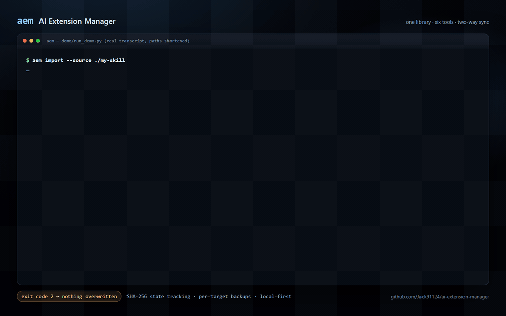
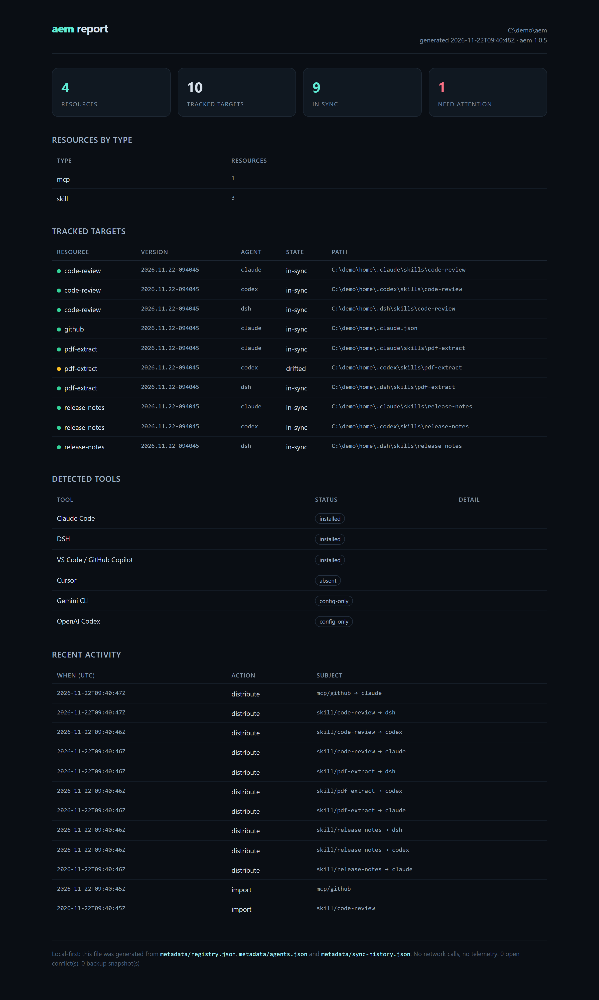

# AI Extension Manager · AI 扩展资源管理助手

**简体中文** | [English](README.md)

### 一个中央库，六个 AI 工具，双向同步，绝不静默覆盖你的改动。

`aem` 把你的 Agent Skill、规则和 MCP 服务器定义集中存放在一个本地库中，再同步到 Claude Code、
OpenAI Codex、Gemini CLI、Cursor、VS Code Copilot 和 DSH。它用 SHA-256 内容哈希和每个目标的
同步记录来判断"谁变了"，而不是"谁的文件更新就覆盖谁"。

**落地页：** <https://jack91124.github.io/ai-extension-manager/zh.html> · [English](https://jack91124.github.io/ai-extension-manager/)

[](https://jack91124.github.io/ai-extension-manager/)
[](https://www.skills.sh/jack91124/ai-extension-manager)


[](https://github.com/Jack91124/ai-extension-manager/actions/workflows/ci.yml)
[](https://github.com/Jack91124/ai-extension-manager/releases/latest)


**快速开始** · [为什么还要一个同步工具](#为什么还要一个同步工具) ·
[60 秒工作流](#60-秒工作流) · [冲突模型](#冲突是怎么判断的) ·
[支持矩阵](#目前支持什么) · [安全设计](#默认安全) · [CLI](#cli-速查) ·
[演示](demo/) · [文档](#文档)

---

## 为什么还要一个同步工具？

每个 AI 编程工具都自创了一套目录：`~/.claude/skills`、`~/.codex/skills`、
`~/.gemini/skills`、`~/.cursor/skills`、`~/.copilot/skills`、`~/.dsh/skills`。
现实结果就是：

- 同一个 Skill 被复制五份，然后在三个地方分别被改过；
- 为一个工具装的 Skill，另外五个工具完全不知道；
- 所谓"同步脚本"直接复制文件，把上周的本地修复静默删掉；
- 没人答得上来："哪些工具装着这个 Skill 的 1.2 版？哪一份已经漂移了？"

`aem` 把**中央资源库当作唯一事实来源**，并精确记录每个工具收到的是哪个版本。正是这份记录让它能
区分"只有库变了""只有工具变了""两边都变了"——并且在最后一种情况下拒绝猜测、拒绝覆盖。

它刻意做成 **local-first（本地优先）**：纯文件、纯 JSON，没有服务器、没有遥测、不需要账号。



<sub>10 秒演示，由真实的 `demo/run_demo.py` 输出渲染而成（[静态版](docs/hero.png)，[生成脚本](docs/make_demo_gif.py)）。</sub>

## 快速开始

需要 **Python 3.9+**，无第三方依赖，支持 Windows、macOS、Linux。

不克隆仓库直接安装（需要 `git`，锁定版本标签以保证可复现）：

```bash
python -m pip install --user "git+https://github.com/Jack91124/ai-extension-manager.git@v1.0.4"
aem init && aem doctor
```

想隔离安装？用 `pipx install "git+https://github.com/Jack91124/ai-extension-manager.git@v1.0.4"`，
或从[最新 Release](https://github.com/Jack91124/ai-extension-manager/releases/latest) 下载 wheel 后 `pip install`。

或者克隆仓库：

```bash
git clone https://github.com/Jack91124/ai-extension-manager.git
# 国内镜像：git clone https://gitee.com/ping-pong-squid-king/ai-extension-manager.git
cd ai-extension-manager
python -m pip install .
aem init          # 创建 ~/.ai-extension-manager
aem doctor        # 检查 Python、路径、注册表、锁和已安装工具
aem scan          # 探测六个 AI 工具及其 Skill 目录
```

不安装也能用——每条命令都可以写成 `python scripts/aem.py <command>`。

如果你已经在用 [`skills`](https://github.com/vercel-labs/skills) CLI，也可以把它当 Agent Skill 安装
（需要 Node 22.20+），同时会在 [skills.sh](https://www.skills.sh/jack91124/ai-extension-manager) 上被收录：

```bash
npx skills add Jack91124/ai-extension-manager
```

仓库根目录本身就是合法 Skill，因此 CLI 会把整套工具（文档、脚本、测试）装进
`.claude/skills/ai-extension-manager` 或 `.agents/skills/ai-extension-manager`。

一台装了三个工具的 Windows 机器上真实的 `aem doctor` 输出：

```text
$ aem doctor
[ok]   python    3.14.4 (requires 3.9+)
[ok]   library   C:\Users\you\.ai-extension-manager is writable
[ok]   registry  0 resources
[ok]   schema    schema 1
[ok]   payloads  all payload directories present
[ok]   lock      no library lock
[ok]   agents    3/6 tools installed; absent: gemini, cursor
[ok]   disk      132.4GB free
[ok]   backups   0 snapshots, 0B
[ok]   conflicts 0 unresolved conflict(s)
result: healthy
```

## 60 秒工作流

```bash
# 1. 从 GitHub 或本地目录导入一个 Skill
aem import --source https://github.com/owner/repo/tree/main/skills/my-skill

# 仓库里打包了多个 Skill：挑一个，或者全部导入
aem import --source https://github.com/owner/repo --pick skills/pdf

# 2. 分发到需要的工具（--agent 可重复）
aem sync --direction distribute --agent claude --agent codex --resource my-skill

# 3. 证明各工具副本与中央库一致
aem verify --all
aem status
```

一切可回滚：`aem backups` 列出快照，`aem restore` 恢复旧版本，`aem compare` 在中央库版本、
历史快照和工具副本之间给出 unified diff。

想在某个工具里改 Skill 再把改动拉回来？用 `aem sync --direction both`：它会安全导入目标侧的改动，
一旦两边都改过，就以退出码 `2` 停下，不写任何文件。

## 一页看清整个库

`aem report` 把注册表里的全部信息渲染成一个自包含的 HTML 文件：按类型统计的资源、每个已跟踪目标
的实时状态（一致 / 漂移 / 缺失）、本机探测到的工具，以及最近的操作日志。文件只写在本地，离线可看，
不发起任何网络请求；需要给脚本用时加 `--json`。

```bash
aem report                 # 输出 ./aem-report.html 并打印路径
aem report --open          # 输出后直接打开浏览器
aem report --json          # 机器可读的摘要，便于 CI 或看板
```



## 冲突是怎么判断的？

每个资源保存一个 SHA-256 目录树哈希；每个目标保存三个事实：同步来源哈希（`source_hash`）、
实际写入哈希（`target_hash`）和同步时间（`synced_at`）。据此得到：

| 状态 | 发生了什么 | 默认动作 |
|---|---|---|
| **A** | 只有中央库变了 | 备份后更新目标 |
| **B** | 只有目标变了 | 保留目标，建议反向导入 |
| **C** | 两边都变了 | **冲突：不写任何文件，退出码 2** |
| **D** | 目标被删除了 | 报告缺失，不静默重建 |
| **E** | 目标目录不存在 | 报告不可用，不臆造路径 |
| untracked | 存在一份从未同步过的副本 | 内容相同则认领；不同则冲突 |

冲突会连同证据（哈希、路径、时间戳）写入 `conflicts/` 目录。处理方式必须显式指定：

```bash
aem compare --left resource:my-skill --right agent:claude:my-skill --diff
aem sync --direction distribute --agent claude --resource my-skill --on-conflict library   # 保留中央库
aem sync --direction import    --agent claude --on-conflict new-version                    # 把目标存为新版本
aem restore --resource my-skill --version <label>                                          # 回滚
```

默认不覆盖任何东西——冲突时不覆盖，第一次遇到未跟踪副本时也不覆盖。

完整论证（为什么修改时间不能当冲突策略、猜错一次要付出什么代价）见
[docs/why-sync-overwrites.md](docs/why-sync-overwrites.md)。

## 目前支持什么

| 工具 | Skills | 规则 | MCP | 插件 | 验证程度 |
|---|---|---|---|---|---|
| **Claude Code** | 复制 / 链接 | `CLAUDE.md` | JSON 合并 | marketplace 命令 | 本机实测（CLI 2.1.318） |
| **OpenAI Codex** | 复制 / 链接 | `AGENTS.md` | 手动（TOML） | marketplace 命令 | 配置目录已实测；CLI 未安装 |
| **DSH** | 复制 / 链接 | `AGENTS.md` | 通过插件 | `dsh plugin add` | 本机实测（0.2.0-rc.2） |
| **Gemini CLI** | 复制 / 链接 | `GEMINI.md` | JSON 合并 | `gemini extensions install` | 官方文档；未跑运行时 |
| **Cursor** | 复制 / 链接 | `.cursor/rules` | JSON 合并 | 仅 marketplace UI | 路径部分验证（未安装） |
| **VS Code / Copilot** | 复制 / 链接 | instructions 文件 | JSON 合并 | VS Code 扩展 | 官方文档 + 本机 VS Code 1.115 |

插件代码**绝不跨工具复制**。插件通过目标工具自己的机制安装；`aem` 只返回准确命令，
对工具专属插件拒绝跨工具搬运。

## 各工具的技能目录

| 工具 | 用户级技能目录 | 项目级技能目录 | MCP 配置 |
|---|---|---|---|
| **Claude Code** | `~/.claude/skills` | `.claude/skills` | `~/.claude.json`、`.mcp.json` |
| **OpenAI Codex** | `~/.codex/skills`、`~/.agents/skills` | `.agents/skills`、`.codex/skills` | `~/.codex/config.toml` |
| **Gemini CLI** | `~/.gemini/skills`、`~/.agents/skills` | `.gemini/skills`、`.agents/skills` | `~/.gemini/settings.json` |
| **Cursor** | `~/.cursor/skills` | `.cursor/skills` | `~/.cursor/mcp.json` |
| **VS Code / Copilot** | `~/.copilot/skills` | `.github/skills` | `~/.copilot/mcp-config.json` |
| **DSH** | `~/.dsh/skills`、`~/.agents/skills` | `.dsh/skills`、`.agents/skills` | 通过已安装插件 |

这些路径与 `aem scan` 读取的是同一份注册表，所以扫描结果和上表永远不会不一致；它还会告诉你
这些目录在**你这台机器上**是否存在。完整版（规则文件、插件机制、官方文档链接、逐行验证等级）见
**[jack91124.github.io/ai-extension-manager/where.html](https://jack91124.github.io/ai-extension-manager/where.html)**，
面向 AI 抓取的机器可读摘要见 [docs/llms.txt](docs/llms.txt)。
## 默认安全

- **导入前扫描**——危险 Shell 模式、高风险脚本、密钥；高风险需 `--allow-risk`，
  凭据一律拒绝（MCP 可改写成 `${ENV_VAR}` 占位符）。
- **覆盖前备份**——任何目标或中央库 payload 被修改前都先做快照。
- **绝不擅自删除**——没有显式 uninstall/restore 命令，不动别的工具里的资源。
- **拒绝 git URL 重写**——防止 `github.com` 被劫持到第三方镜像（`--allow-mirror` 才能放行）。
- **不外传密钥**——库纯本地，`metadata/registry.json` 只存哈希，不存密钥。
- **处处可 dry-run**——`--dry-run` 只展示计划，不留下 journal。

完整策略见 [references/security-policy.md](references/security-policy.md)。

## CLI 速查

| 命令 | 作用 |
|---|---|
| `aem init` | 创建中央库目录结构 |
| `aem doctor` | 诊断 Python、路径、注册表、schema、锁、工具、磁盘 |
| `aem status` | 一张表列出每个资源 × 工具，`--strict` 遇漂移即失败 |
| `aem scan` | 探测工具、版本和 Skill 目录 |
| `aem dirs` | 解析六个工具真实的 skills / MCP / rules 路径（含 scope 与是否存在） |
| `aem detect --path P` | 判断 P 是 Skill / Plugin / MCP / 规则 |
| `aem import --source P` | 导入本地路径或 GitHub URL（多资源源用 `--pick` / `--all`） |
| `aem sync --direction import|distribute|both` | 双向同步并检测冲突 |
| `aem adopt` | 导入方向快捷命令：把各工具新增/变更的资源吸回中央库 |
| `aem distribute` | 分发方向快捷命令：把中央库资源推送到工具（先备份） |
| `aem compare --left A --right B --diff` | 哈希清单 + unified diff |
| `aem verify --all` | 校验已安装副本与中央库是否一致 |
| `aem report` | 一页自包含 HTML 报告（`--json`、`--open`） |
| `aem backup` / `backups` / `restore` / `prune` | 快照与回滚 |

所有命令都接受 `--home`、`--workspace`、`--json`。退出码：`0` 成功，`1` 错误，
`2` 冲突或存在差异。完整参数见 [references/cli-reference.md](references/cli-reference.md)。

## 演示

仓库自带一个完全自包含的演示，绝不碰你真实的工具目录：

```bash
python demo/run_demo.py
```

它会创建假中央库和六个假工具 home，导入一个 Skill，分发到三个工具，校验哈希，修改其中一份副本，
展示漂移，再修改上游，最后触发一次真实的 C 状态冲突并拒绝覆盖。完整运行记录见
[demo/demo-output.txt](demo/demo-output.txt)。

## 文档

| 文档 | 内容 |
|---|---|
| [SKILL.md](SKILL.md) | 面向 AI Agent 的技能：何时使用、决策规则、命令配方 |
| [references/architecture.md](references/architecture.md) | 分层、数据模型、目录结构 |
| [references/resource-types.md](references/resource-types.md) | Skill / Plugin / MCP / 规则兼容性 |
| [references/agent-compatibility.md](references/agent-compatibility.md) | 各工具路径与验证状态 |
| [references/synchronization-engine.md](references/synchronization-engine.md) | 导入 / 分发协议与状态机 |
| [references/conflict-resolution.md](references/conflict-resolution.md) | A–E 状态与处理手册 |
| [references/security-policy.md](references/security-policy.md) | 扫描、密钥、确认策略 |
| [references/installation-methods.md](references/installation-methods.md) | 复制 / 链接 / 工具原生安装 |
| [references/dsh-plugin-spec.md](references/dsh-plugin-spec.md) | 规划中的 GUI/执行插件（尚未实现） |
| [docs/where.html](https://jack91124.github.io/ai-extension-manager/where.html) | 各工具技能 / MCP / 规则目录（生成页） |
| [docs/llms.txt](docs/llms.txt) | 面向 AI 抓取的机器可读摘要 |
| [docs/alternatives.md](docs/alternatives.md) | 与其他技能管理工具的诚实对比（含何时该选它们） |
| [docs/launch.md](docs/launch.md) | 发布定位、文案与渠道清单 |
| [docs/ROADMAP.md](docs/ROADMAP.md) | 后续路线图 |

## 状态与限制

这是可用的 **v1.0 CLI + Agent Skill**，不是完成品：

- ✅ 导入、分发、双向同步、冲突检测、备份、校验、对比、恢复；
- ✅ 六个适配器（附诚实的验证等级）、安全扫描、JSON 契约；
- ✅ 28 个场景测试，全部跑在一次性假 home 上；
- 🚧 DSH Plugin 面板**只有规格，尚未实现**——这里不声称存在 GUI；
- 🚧 插件安装委托给各工具原生命令（暂不自动安装）；
- ⚠️ Gemini CLI 与 Cursor 只按官方文档/路径映射验证，未跑真实运行时；
- ⚠️ Codex 的 MCP 写入是手动的（有意不自动改 TOML）。

## 参与贡献

欢迎 Issue 和 PR——见 [CONTRIBUTING.md](CONTRIBUTING.md) 与 [SECURITY.md](SECURITY.md)。
场景测试用纯 Python 即可运行：

```bash
python evals/run_tests.py
```

## 许可证

MIT —— 见 [LICENSE](LICENSE)。